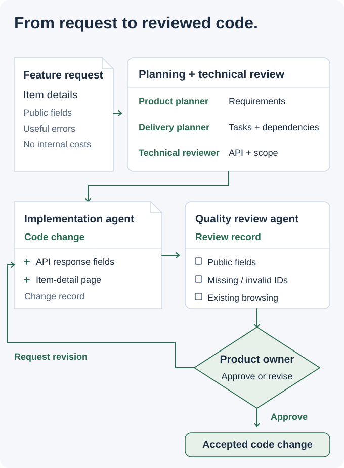

# AgentCrew | AI Software Delivery Workflow

> [!CAUTION]
> **Public workflow documentation.** This repository contains workflow documentation and example task templates; the application source is private. It does not publish a runnable agent orchestrator or executed test results. The storefront is an illustrative task, and diagrams explain the workflow.

## From a feature request to a reviewed code change

AI can help write code, but a software task also needs clear requirements, technical decisions, and review. I designed AgentCrew to connect those steps for developers and product owners.

**My contribution:** I defined the planning, implementation, and review responsibilities, the information each stage passed on, and the points where a person approved the design or change.

<picture>
  <source media="(max-width: 540px) and (prefers-color-scheme: dark)" srcset="assets/ai-story-v5-mobile-dark.svg">
  <source media="(max-width: 540px)" srcset="assets/ai-story-v5-mobile-light.svg">
  <source media="(prefers-color-scheme: dark)" srcset="assets/ai-story-v5-dark.svg">
  
</picture>

### A concrete task: show a shopper an item's details

A shopper opens a catalog item before deciding whether to buy it. The task covers an API endpoint and a browser page: show public item fields, handle missing or invalid identifiers, and keep internal purchasing costs out of the response.

I used that task to organize the workflow:

1. **Plan:** define the shopper's need and the expected behavior.
2. **Review the approach:** agree on the API fields, error handling, and affected parts of the application.
3. **Implement:** prepare the code changes and record what changed.
4. **Check:** compare the change with the requirements and record the checks and findings.
5. **Approve or revise:** the product owner reviews the change and decides whether it is ready.

### Keep the next person able to continue

Each stage receives the requirements and recorded decisions. A reviewer can see why a field belongs in the response, how an unknown item should behave, and which existing browsing behavior must still work.

This is the engineering problem behind AgentCrew: connecting AI-assisted work to a change a person can understand, inspect, and approve.

<strong>Engineering details: agent responsibilities, task records, and review</strong>

| Responsibility | Output for the next stage |
| --- | --- |
| Product planning | Requirements and acceptance criteria. |
| Delivery planning | Tasks, dependencies, and progress. |
| Technical review | API contracts, design decisions, and scope. |
| Implementation | Code changes and a record of the work. |
| Quality review | Check results, findings, and requested corrections. |
| Human approval | A decision to accept, revise, or defer the change. |

<picture>
  <source media="(prefers-color-scheme: dark)" srcset="https://raw.githubusercontent.com/MahdiHajjHassan/ai-development-workflow/main/assets/review-workflow-dark.svg">
  
</picture>

### Task records

I organized requests, decisions, progress, and deliverables together. Project instructions held coding conventions, reusable skills described recurring work, and a linked knowledge base made the decisions easy to find. Before resuming a task, the workflow compared the recorded progress with the current repository.

### Review criteria

For the item-detail task, review covers public response fields, invalid and missing identifiers, internal-field exclusion, and existing catalog browsing. The review record connects each requirement to the changed code and check results.

The example application uses an Express REST API and a JavaScript browser application.

- [Workflow responsibilities and handoffs](https://github.com/MahdiHajjHassan/ai-development-workflow/blob/main/docs/workflow.md)
- [Item-detail task brief](https://github.com/MahdiHajjHassan/ai-development-workflow/blob/main/examples/task-brief.md)
- [Code review checklist](https://github.com/MahdiHajjHassan/ai-development-workflow/blob/main/examples/task-review.md)

[Back to my portfolio](https://github.com/MahdiHajjHassan)
