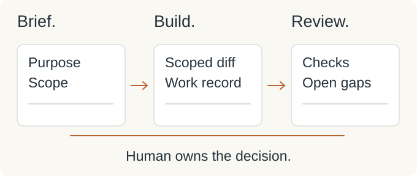

# AgentCrew

## My AI engineering team: planning, implementation, and review

I want an AI-assisted task to carry its purpose all the way to review.
AgentCrew presents my approach to that work: give each responsibility a clear brief,
keep decisions with the task, and ask for evidence before accepting a change.

For a developer or product owner, the useful handoff is more than “the code is ready.”
It explains what changed, why it belongs in the product, and what still needs checking.
This independent reference follows that handoff through a fictional storefront.

*Public showcase: workflow documentation and illustrative task templates. Separate from my final-year multi-agent orchestration project.*

<picture>
  <source media="(max-width: 540px) and (prefers-color-scheme: dark)" srcset="assets/ai-story-mobile-dark.svg">
  <source media="(max-width: 540px)" srcset="assets/ai-story-mobile-light.svg">
  <source media="(prefers-color-scheme: dark)" srcset="assets/ai-story-dark.svg">
  
</picture>

*Concept illustration of the workflow and its handoffs.*

### The context should travel with the task

A request can sound small and still contain several decisions.
Which behavior matters to the user? Which information can be shown?
What must keep working when the change is finished?

My role is to define the brief, make the design decisions, and set the checkpoints.
I organize responsibilities around outputs another person can inspect.
The task record connects the request to the proposed change and the eventual review.

### One shopper, one bounded change

In the fictional storefront, a shopper opens a catalog item to learn more before buying.
The requested change is an item-detail endpoint and a browser view.
Payment, authentication, inventory management, and checkout stay beyond this task.

The brief turns that simple interaction into specific expectations:

- A known item shows its public catalog fields.
- An unknown item gives a useful not-found message.
- Invalid identifiers receive consistent validation.
- Internal purchasing costs stay out of the response and the view.
- Existing catalog browsing continues to work.

Before implementation, I need the public response contract and the existing error convention settled.
Those choices tell the implementer where the task begins and ends.
They also give the reviewer something concrete to compare with the change.

### A handoff is an artifact

Planning produces the brief and acceptance criteria.
Delivery planning breaks the scope into tasks and dependencies; technical review resolves the boundaries.
Implementation should return a scoped diff and a work record.
Quality review should connect each requirement to the checks actually performed.

In this example, the review record is deliberately blank: every scenario is **Not executed**.
It shows what evidence belongs there when someone performs the work.
A plausible patch still leaves the owner with a decision to make.

I keep that accountability with the human responsible for the product:
accept the change, request a revision, or defer it with the remaining concerns recorded.

<strong>Workflow mechanics, responsibilities, and review criteria</strong>

### Responsibilities and outputs

| Responsibility | What the next stage receives |
| --- | --- |
| Product planning | Scope and acceptance criteria |
| Delivery planning | Tasks, dependencies, and progress |
| Technical review | Design choices and implementation boundaries |
| Implementation | Reviewable changes and a work record |
| Quality review | Observed checks, findings, and gaps |
| Human ownership | Decisions on tradeoffs, acceptance, and release |

### Recover the reasoning before continuing

Project instructions hold conventions and boundaries; reusable skills guide recurring work.
Task folders keep requests, decisions, progress, and deliverables together.
A linked knowledge base makes those records discoverable.
Continuation starts by checking the recorded state against the current repository.

<picture>
  <source media="(prefers-color-scheme: dark)" srcset="https://raw.githubusercontent.com/MahdiHajjHassan/ai-development-workflow/main/assets/review-workflow-dark.svg">
  
</picture>

*Existing public workflow diagram; its first-person labels represent the fictional storefront's human owner.*

### What would send the task back for revision?

The review needs evidence for the actual diff, requirement coverage, and any extra scope.
An exposed purchasing-cost field, unclear invalid-ID behavior, or broken browsing would require correction.
Missing check evidence remains a gap; generated tests and assertions alone do not establish a pass.
The owner records the decision after reviewing the change and the evidence.

### Inspect the public artifacts

- [Workflow mechanics](https://github.com/MahdiHajjHassan/ai-development-workflow/blob/main/docs/workflow.md): responsibilities, project context, and continuation.
- [Fictional task brief](https://github.com/MahdiHajjHassan/ai-development-workflow/blob/main/examples/task-brief.md): the item-detail scope, criteria, and open technical questions.
- [Blank review record](https://github.com/MahdiHajjHassan/ai-development-workflow/blob/main/examples/task-review.md): scope review, check evidence, and the human decision.

The documented storefront context uses an Express REST API and a JavaScript browser application.
Its original application source is private. This public repository explains the workflow through documentation
and templates; it provides no runnable agent orchestrator or measured productivity result.

[Mahdi Hajj Hassan](https://github.com/MahdiHajjHassan)
