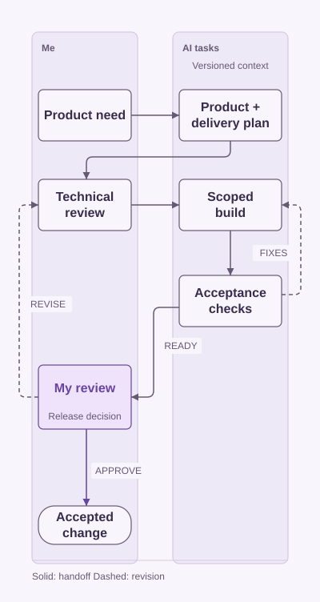

# AI development workflow

Outside my job, I use AI agents to move personal software projects from an idea to changes I can inspect and test. I organize the work around product planning, delivery planning, technical review, implementation, and QA, while keeping system design and release decisions with me.

This repository documents that independent workflow and a demonstration for a fictional storefront. It includes illustrative task templates; the original application source remains private.

## How I organize the work

<picture>
  <source media="(prefers-color-scheme: dark)" srcset="assets/review-workflow-dark.svg">
  
</picture>

Each stage has a concrete output. A task carries requirements and constraints into implementation, QA checks the result, and feedback sends it back for revision. Passing an automated check does not replace my decision about the design or release.

## What I put around the application

- Versioned project instructions and reusable skills.
- Task folders that hold context, progress, and deliverables together.
- Staged changes that can be reviewed before acceptance.
- A linked knowledge base built from project documents.

The aim is to make decisions and changes easy to follow across tasks, instead of keeping the whole project in one long conversation.

## Technical detail and examples

- [Workflow mechanics](docs/workflow.md): responsibilities, artifacts, review, and continuation.
- [Example task brief](examples/task-brief.md): a fictional storefront change with bounded scope.
- [Example review record](examples/task-review.md): a blank evidence template, not a test-results claim.

[Mahdi Hajj Hassan](https://github.com/MahdiHajjHassan) · [Doctoleb](https://github.com/MahdiHajjHassan/doctoleb-showcase)
